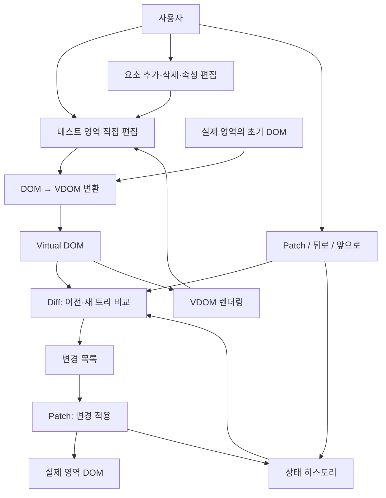
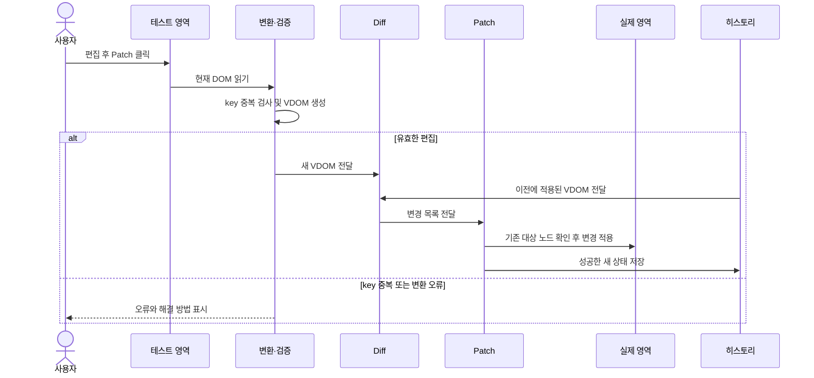
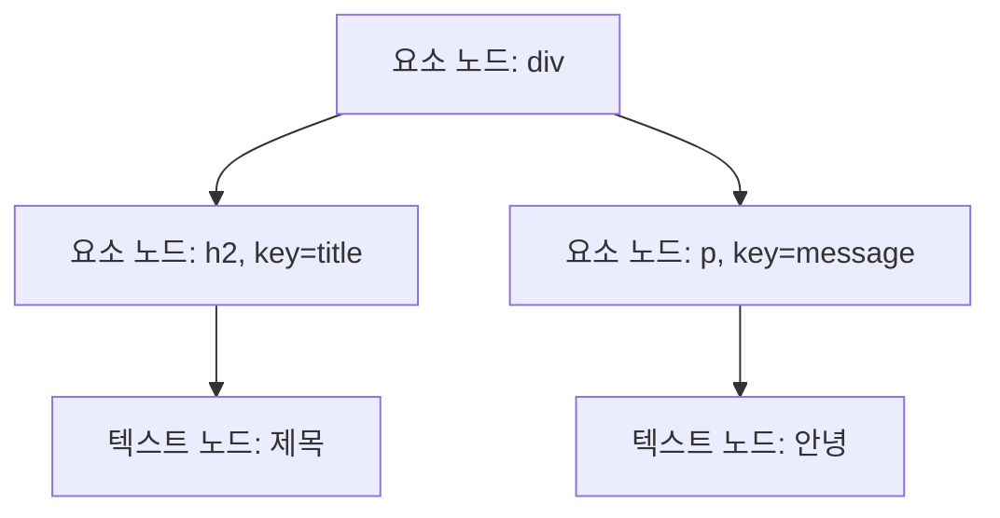
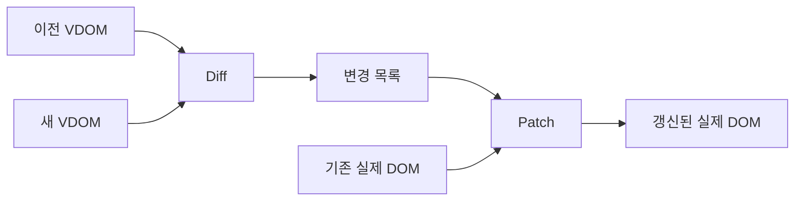
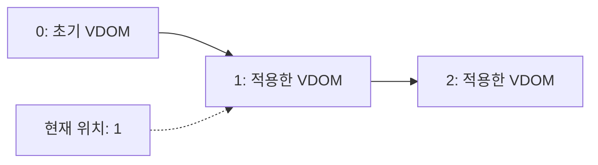

# Phase 1 설계

이 문서는 논의하면서 갱신한다. 확정한 결정과 검토 중인 제안을 구분한다.

현재 구현 상황과 검증 결과는 [Phase 1 구현 현황](phase1-progress.md)을 참고한다.

## 목표

브라우저 DOM을 Virtual DOM으로 변환하고, 이전 트리와 새 트리의 차이를 찾아 실제 영역에 필요한 변경만 적용한다. 사용자는 테스트 영역을 직접 편집하고 Patch와 뒤로·앞으로 버튼으로 변화를 확인한다.

## 화면과 데이터 흐름

1. 페이지를 열면 실제 영역의 샘플 DOM을 Virtual DOM으로 변환하고 테스트 영역을 렌더링한다.
2. 사용자가 테스트 영역에서 내용을 직접 편집한다.
3. Patch를 누르면 테스트 영역을 새 Virtual DOM으로 변환한다.
4. Diff가 이전 Virtual DOM과 새 트리를 비교해 변경 목록을 만든다.
5. Patch가 변경 목록을 실제 영역에 적용하고, 새 트리를 히스토리에 저장한다.
6. 뒤로·앞으로 이동할 때 선택한 히스토리 상태를 실제 영역과 테스트 영역에 반영한다.

## 기술 스택

- 구현 언어 — Vanilla JavaScript. HTML과 CSS로 화면을 만든다.
- 과제 조건 — React, Vue 등 외부 UI 프레임워크를 사용하지 않는다.
- 개발 서버 — Vite를 사용한다.
- 단위 테스트 — Vitest와 jsdom을 사용해 VDOM 변환, Diff, Patch를 검증한다.
- 브라우저 기능 테스트 — Playwright를 사용해 직접 편집, Patch, 뒤로·앞으로를 검증한다.
- jsdom은 브라우저를 모사하므로 실제 편집과 포커스 등의 동작은 브라우저 테스트로도 확인한다.

[테스트 도구 결정 기록](decisions/2026-11-07-testing-tools.md)

[개발 서버 결정 기록](decisions/2026-11-07-vite.md)

[구현 언어 결정 기록](decisions/2026-11-07-javascript.md)

## 전체 구조도

아래 구조는 구현을 위한 초안이다. 모듈 이름과 함수 시그니처는 이해를 돕기 위한 예시이며, 확정된 사용자 결정은 아래 별도 절에 기록한다.



초기화, Patch, 히스토리 이동은 아래의 실행 순서를 따른다. 다이어그램의 화살표는 모듈 사이에 오가는 데이터와 호출 관계를 간략히 나타낸다.

### 화면 구성

```text
┌──────────────────────────────────────────────────────────────┐
│ [Patch] [뒤로가기] [앞으로가기]  현재 히스토리 위치          │
├─────────────────────────────┬────────────────────────────────┤
│ 실제 영역                   │ 테스트 영역                    │
│ 마지막으로 적용된 결과      │ 직접 편집하는 DOM              │
│                             │                                │
│                             │ 선택 요소와 편집 도구          │
│                             │ [요소 추가] [삭제] [속성 편집] │
├─────────────────────────────┴────────────────────────────────┤
│ 변경 목록 또는 오류 표시 영역 — 구체적인 표시 방식은 미결    │
└──────────────────────────────────────────────────────────────┘
```

- 테스트 영역에서 글자를 직접 편집하고, 미리 준비한 버튼으로 요소를 추가한다. 새 요소는 선택한 요소 뒤에 추가한다.
- 자유 편집 요구를 위해 요소 삭제와 속성 변경을 제공한다. 버튼 종류, 중첩 요소 편집 방식과 정확한 지원 범위는 구현하며 정한다.
- 중복 key가 있으면 충돌을 보여주고 Patch를 막는다. 사용자가 새 요소를 선택해 새 key를 부여할 수 있어야 한다.
- Patch하지 않은 수정이 있으면 히스토리 이동 전에 확인하고, 취소하면 편집 내용을 유지한다.

### 책임별 모듈

| 책임 | 입력 | 결과 또는 역할 |
| --- | --- | --- |
| DOM 변환 | 브라우저 DOM | 태그·속성·텍스트·key·자식을 담은 VDOM |
| VDOM 렌더링 | VDOM | 초기 화면 또는 테스트 영역에 표시할 DOM |
| Diff | 이전 VDOM, 새 VDOM | 변경 전 경로를 사용하는 변경 목록 |
| Patch | 실제 DOM, 변경 목록 | 대상 DOM 노드를 찾아 필요한 변경을 적용 |
| 히스토리 | 적용된 VDOM 스냅샷, 현재 위치 | 뒤로·앞으로 이동과 새 이력 저장 |
| 편집 화면 | 사용자 입력과 선택 | 테스트 DOM 편집, 요소 추가·삭제, 속성 수정, 오류 표시 |

각 책임은 서로 분리해 검증한다. 실제 파일 분할과 함수 이름은 아직 확정하지 않았다.

### Patch 실행 순서



- 새 상태를 적용한 뒤에만 해당 스냅샷을 히스토리에 저장한다.
- 기존 대상은 변경 전 트리의 경로로 찾고, 구조를 변경하기 전에 필요한 DOM 참조를 확보한다.
- 중간 삽입·삭제·이동이 섞인 변경 목록의 순서와 실패 처리 방식은 테스트를 통해 구체화한다.

### 히스토리 이동 순서

1. 테스트 영역에 적용하지 않은 변경이 있다면 이동 여부를 확인한다. 취소하면 편집 내용을 유지한다.
2. 현재 스냅샷과 이동할 스냅샷을 비교해 실제 영역에 변경을 적용한다.
3. 적용에 성공하면 테스트 영역을 이동할 스냅샷으로 갱신하고 현재 위치를 변경한다.
4. 뒤로 간 상태에서 새 Patch가 성공하면 현재 위치 뒤의 이력을 제거하고 새 스냅샷을 추가한다.

### 테스트 계획

| 검증 대상 | 확인할 동작 |
| --- | --- |
| DOM 변환·렌더링 | 중첩 요소, 속성, 텍스트와 key가 변환·렌더링 과정에서 보존되는지 |
| Diff | 추가, 삭제, 교체, 텍스트·속성 변경과 key 기반 삽입·이동을 구분하는지 |
| Patch | 변경 결과가 목표 트리와 같고 변경 없는 요소와 입력창 DOM이 유지되는지 |
| key | 중복 key에서 Patch가 중단되고 사용자가 해결한 뒤 다시 적용할 수 있는지 |
| 히스토리 | 초기 상태, 뒤로·앞으로, 미적용 변경의 확인·취소, 뒤로 간 뒤 새 Patch를 검증 |
| 브라우저 기능 | 직접 편집, 버튼 조작, 속성 변경과 오류 표시를 실제 상호작용으로 검증 |

Phase 2에서는 컴포넌트가 생성한 VDOM과 Phase 1이 만든 VDOM이 동일한 Diff·Patch를 사용할 수 있도록 인터페이스를 유지한다. Phase 2의 컴포넌트와 Hook 구현은 별도 단계에서 진행한다.

## 데이터 설계 초안

아래 필드 이름과 코드 형식은 이해를 돕는 제안이다. 실제 인터페이스와 세부 타입은 구현과 테스트를 통해 구체화한다.

### Virtual DOM 트리



요소 노드는 태그 이름, 관리용 key, 일반 속성, 자식 목록을 담고, 텍스트 노드는 문자열을 담는다. DOM의 관리용 `data-key`는 VDOM의 key로 읽는 방안이다. 일반 속성과 key의 구체적 저장 규칙은 구현 시 정한다.

```js
// 요소 노드와 텍스트 노드 예시
{
  type: "element",
  tag: "p",
  key: "message",
  attributes: { class: "greeting" },
  children: [
    { type: "text", value: "안녕" }
  ]
}
```

트리는 실제 DOM과 독립적인 데이터다. Phase 1은 DOM에서 이 트리를 만들고, Phase 2는 컴포넌트에서 같은 형태의 트리를 만든다. 요소 외 노드의 지원 범위와 key가 없는 노드의 비교 규칙은 아직 미결이다.

### 변경 목록과 Patch



예를 들어 `p`를 기준 루트로 보고 그 안의 첫 텍스트가 바뀌었다면, 변경 목록에는 아래와 같은 정보를 담을 수 있다. `path`는 변경 전 트리의 자식 위치를 의미하며, 기준 루트의 경로는 `[]`다.

```js
[
  { type: "TEXT", path: [0], value: "반가워" }
]
```

추가·삭제·교체·속성 변경·이동 항목의 상세 형식과 적용 순서는 아직 확정하지 않았다. 삽입과 이동은 대상과 기준 위치를 표현해야 하며, 여러 작업이 함께 있을 때 기존 DOM 노드의 식별이 유지되는지 테스트해야 한다.

### 상태 히스토리



히스토리는 각 시점의 독립된 VDOM 스냅샷 목록과 현재 위치를 보관하는 방안이다. 적용되지 않은 테스트 영역 편집은 현재 스냅샷과 구분한다. 뒤로 간 뒤 새 Patch를 적용하면 현재 위치 뒤의 스냅샷을 버리고 새 상태를 추가한다. 스냅샷 복사와 미적용 변경 감지 방법은 구현 시 정한다.

## 확정한 설계

### 테스트 영역 편집

- 화면을 직접 편집한다.
- 태그 추가에는 미리 준비한 버튼을 사용한다.
- 새 요소는 선택한 요소와 같은 부모 안에서 선택한 요소 바로 뒤에 추가한다.
- 선택한 이유는 미기록이다.

[편집 방식 결정 기록](decisions/2026-11-07-phase1-editing.md)

### Diff와 Patch

- Diff는 이전 트리와 새 트리의 변경 목록을 만든다.
- Patch는 변경 목록을 읽어 실제 DOM에 반영한다.
- 변경 대상은 실제 DOM 노드 대신 Virtual DOM의 위치 경로로 표시한다.
- 경로는 변경 전 Virtual DOM을 기준으로 한다. Patch는 구조 변경 전에 기존 대상 DOM 노드들을 먼저 찾아둔다.
- Diff와 Patch를 분리한 이유는 각 단계의 결과를 따로 확인하고 설명하기 쉽게 하기 위해서다.
- 경로 선택의 이유는 미기록이다.

[Diff와 Patch 결정 기록](decisions/2026-11-07-diff-patch.md)

### 히스토리

- 히스토리는 한 줄로 관리하고 현재 위치에서 뒤로·앞으로 이동한다.
- 뒤로 이동한 뒤 새로운 Patch를 적용하면 현재 위치 이후의 기록을 제거하고 새 상태를 추가한다.
- 실제 영역과 테스트 영역을 이동한 상태로 함께 갱신한다.
- 적용하지 않은 테스트 영역 변경이 있으면 뒤로·앞으로 이동하기 전에 확인한다.
- 사용자가 이동을 취소하면 현재 편집 내용을 유지한다.
- 선택한 이유는 미기록이다.

[히스토리 결정 기록](decisions/2026-11-07-history.md)

## 검토 중인 세부 설계

### Virtual DOM 표현

요소 노드에 태그 이름, 속성, 자식 목록을 두고 텍스트 노드에 텍스트 값을 두는 방안을 제안했다. 구체적인 자료구조와 지원 범위는 아직 확정하지 않았다.

### Phase 2 재사용 제안

- Phase 1은 DOM에서 Virtual DOM을 만들고, Phase 2는 루트 함수형 컴포넌트에서 Virtual DOM을 만든다. 두 경로는 같은 노드 표현과 Diff·Patch를 사용한다.
- 공통 VDOM은 직접 편집 화면에 의존하지 않는다. DOM 변환과 컴포넌트용 생성은 별도 진입점으로 둔다.
- 컴포넌트의 이벤트 핸들러와 입력 요소의 값·체크 상태를 표현하고 DOM에 반영하는 방식을 설계한다. Phase 1 히스토리에는 편집한 트리 상태를 저장하며 함수 직렬화에 의존하지 않는다.
- Phase 2에서 Hook과 State는 루트 컴포넌트가 관리하고, 자식 컴포넌트는 props를 받는 순수 함수로 구성한다.

### 편집 범위와 key 없는 노드 제안

- 직접 편집 화면에서 텍스트와 요소를 수정하고, 요소 추가·삭제 및 속성 변경을 제공한다. 구체적인 조작과 지원 범위는 정해야 한다.
- key가 있는 형제는 key로 대응하고, key가 없는 노드는 key가 없는 형제 사이의 위치를 기준으로 비교하는 방안을 검토한다. 텍스트 노드도 고려한다.
- 같은 부모 내 중복 key는 이미 합의한 대로 사용자에게 알리고 Patch를 중단한다. 혼합된 형제의 삽입·삭제 시 예상 동작을 테스트로 명확히 해야 한다.

### Diff가 찾을 변화

요소 추가, 요소 삭제, 요소 교체, 텍스트 변경, 속성 변경을 기본 사례로 논의했다. Key가 있는 형제 요소의 이동도 처리한다.

구현 초안은 변경 전 경로로 기존 노드를 확보하고, 삽입·이동 시 같은 부모의 기준 형제 노드를 활용하는 것이다. 맨 뒤 삽입, 여러 요소의 삽입·삭제·이동이 함께 발생하는 경우와 기준 형제의 삭제는 구현과 테스트를 통해 적용 순서를 정한다. 이 세부 표현은 확정한 사용자 결정이 아니다.

### 형제 요소 비교와 key

- 초기 요소와 버튼으로 추가한 요소에 key를 자동으로 부여하고 DOM의 관리용 `data-key` 속성에 저장한다.
- DOM을 VDOM으로 변환할 때 key를 읽고 히스토리에도 보관해 이동 시 복원한다.
- key가 있는 형제는 key로 대응해 기존 DOM을 가능한 한 유지한다. key가 없는 형제는 서로 등장 순서대로 대응한다.
- 같은 부모 안에서 key 중복이 발견되면 Patch를 중단하고 중복된 요소를 표시한다. 사용자는 새 요소를 선택해 새 key를 부여한 뒤 다시 Patch할 수 있다.
- 기존 대상은 변경 전 경로로 찾는다. 삽입·이동을 실제 DOM에 적용하는 순서는 구현하며 검증한다.
- 사용자는 자동 생성과 DOM 속성 저장에 대한 제안을 선택했다. 구체적인 사용자 이유는 미기록이다.

[key 비교 결정 기록](decisions/2026-11-07-keyed-diff.md)

## 구현하면서 구체화할 사항

- 제공할 추가 버튼과 요소를 선택하지 않았을 때의 동작
- 요소 삭제와 속성 편집 방법
- 변경 목록의 자료구조, 삽입·이동 위치 표현과 Patch 적용 순서
- key 누락이 편집 화면에서 발생했을 때의 처리
- 브라우저 입력 요소의 값과 체크 상태 등 지원 범위
- 단위 테스트와 브라우저 상호작용 검증 방식


## 2026-11-10 구현된 세부 동작

위 초안과 검토 기록은 논의 이력으로 보존한다. 현재 Phase 1은 `src/main.js`에서 직접 편집·선택·key 관리·히스토리를 연결한다.

- 초기화와 직접 편집 시 빠진 key를 보충한다. 기존 key는 유지하고, 형제 중복은 표시한 뒤 Patch를 막는다.
- 선택은 클릭과 요소 목록으로 제공한다. 비활성 입력 요소도 목록으로 선택할 수 있다. 부모 선택으로 중첩 구조를 탐색한다.
- 선택이 없으면 루트 마지막에 추가한다. 추가 태그와 지원 속성의 구체적 목록은 README에 기록한다.
- 선택·중복 표시용 스타일은 편집 DOM 외부에 두어 VDOM에 섞이지 않게 한다.
- 편집 시 변경 목록을 미리 계산한다. 적용할 변경이 없으면 새 히스토리를 저장하지 않는다.
- 히스토리의 스냅샷은 일반 객체 데이터이며 새 Patch 성공 후 복제해 보관한다. 이동은 실제 DOM에 Diff·Patch를 적용하고 테스트 DOM을 선택한 스냅샷에서 복원한다.
- 브라우저 직접 편집에 의한 전체 삭제도 루트가 유지되도록 정규화한다. 붙여넣기는 일반 텍스트를 사용한다.
- 테스트·지원 범위와 현재 결과는 [Phase 1 구현 현황](phase1-progress.md)을 따른다.
